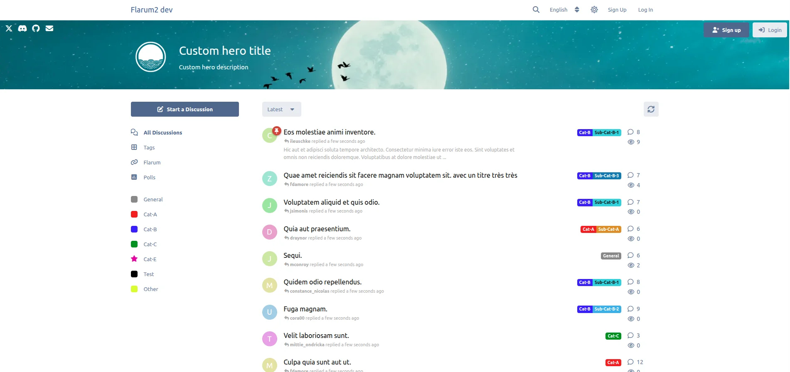
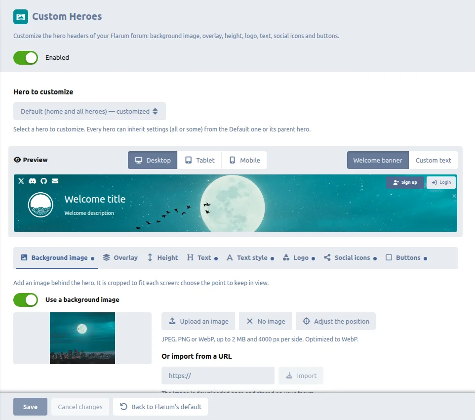

# Custom Heroes

 [](https://packagist.org/packages/walsgit/flarum-custom-heroes) [](https://packagist.org/packages/walsgit/flarum-custom-heroes)

A [Flarum](https://flarum.org) 2.x extension that lets admins customize the hero headers of the forum: background image, overlay, height, logo, text, social icons and buttons, with a live preview in the admin panel.

Without any setting, the forum looks exactly as before: nothing changes until you customize a hero.

## 🖼️ Screenshots





## ✨ Features

- **Background image**: upload an image or import it from a URL, and choose the area that stays visible when it is cropped. It is converted to WebP and stored on your forum in several sizes, so the browser loads the one that fits the screen.
- **Overlay**: add a solid color, a linear gradient (by angle or from a corner), a radial gradient or one color per corner, each with its own opacity. Use it over the image for readability, or alone as a color or gradient background.
- **Height**: keep Flarum's default, pick one of three presets, or set custom heights for desktop, tablet and mobile.
- **Welcome banner**: if enabled, Flarum's welcome banner is still shown and customizable; once closed (or when it is disabled), the home hero can stay with your own title and description, or disappear as in Flarum's native behavior.
- **Text style**: align the text, set its vertical position, adjust the title and description sizes and change the text color.
- **Logo or side image**: add one to the left or right of the text, above the title or in place of it (the title is still read by screen readers), choose its size and hide it on mobile if needed.
- **Social icons**: add Font Awesome icons with their links (web, `mailto:` or `tel:`), place them in a corner or below the text, and set their size and color.
- **Buttons**: add links, or Log in and Sign up buttons that open Flarum's dialogs and only show to guests. Set the icon, style, size, colors and visibility of each button.
- **Mobile**: keep social icons and buttons in place, move them below the text or hide them on small screens.
- **Inheritance**: customize every hero at once with the Default hero, then each type of hero, each tag and each page. A hero inherits the settings of the Default hero (or of its parent) section by section, so you only change what you need.
- **Live preview**: check your changes in the admin panel on desktop, tablet and mobile widths before saving.

Only admins can configure the extension. Every setting is checked on the server, and custom texts are plain text.

## 🧩 Supported heroes

- Flarum: home page (welcome banner, also shown on the tags page) and discussions
- [Tags](https://github.com/flarum/tags): all tags and each tag (a child tag inherits from its parent)
- [Messages](https://github.com/flarum/messages)
- [Deck](https://github.com/flarum/deck)
- [FoF Blog](https://github.com/FriendsOfFlarum/blog) (shows the home page hero)
- [FoF Pages](https://github.com/FriendsOfFlarum/pages): all pages and each page
- [Advanced Pages](https://github.com/TryHackX/flarum-advanced-pages): all pages and each page
- [FoF User Directory](https://github.com/FriendsOfFlarum/user-directory)
- [FoF Polls](https://github.com/FriendsOfFlarum/polls)
- Other extensions that use Flarum's hero component (one shared setting, off by default)

Heroes of optional extensions only show in the admin panel when the extension is enabled.

## 📋 Requirements

- Flarum 2.x
- PHP 8.3 or later, with GD or Imagick and WebP support (the admin panel warns you if WebP is missing)
- PHP's curl extension, to import images from a URL

## 📥 Installation

```sh
composer require walsgit/flarum-custom-heroes
php flarum migrate
php flarum cache:clear
```

Then enable the extension in the admin panel and open its settings.

## ↕️ Updating

```sh
composer update walsgit/flarum-custom-heroes
php flarum migrate
php flarum cache:clear
```

## 🗑️ Uninstalling

Disable the extension, then roll back its migration (this deletes all hero settings) and remove the package:

```sh
php flarum migrate:reset --extension walsgit-custom-heroes
composer remove walsgit/flarum-custom-heroes
php flarum cache:clear
```

The images stay in `public/assets/extensions/walsgit-custom-heroes`: delete that folder if you no longer need them.

## ⚠️ Known limitations

- There is one setting for both light and dark modes.
- Custom texts are the same for every language of the forum.
- FoF Pages and Advanced Pages both use the `/p/…` route: when both are enabled, the pages of one of them cannot be opened. This conflict is between those two extensions; Custom Heroes supports both, but use only one of them.
- Images imported from a URL are downloaded once, when you import them: changing the image at that URL later has no effect.

## 🗒️ Notes

- This extension was entirely vibe coded with [Claude Code](https://claude.com/claude-code).
- Similar extensions exist, like [ernestdefoe/hero-builder](https://discuss.flarum.org/d/39479-hero-builder), but I couldn't find one that had all the features I wanted 😉

## 🔗 Links

- [Packagist](https://packagist.org/packages/walsgit/flarum-custom-heroes)
- [GitHub](https://github.com/WalsGit/flarum-custom-heroes)
- [Issues](https://github.com/WalsGit/flarum-custom-heroes/issues)
- [Donate](https://walsgit.github.io/Donations/)

## 📄 License

Released under the [MIT License](LICENSE.md).
